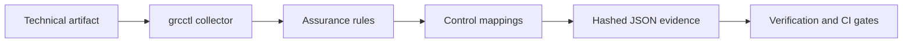

# GRC Engineering OS

[](https://github.com/kulpritsec/grc-engineering-os/actions/workflows/ci.yml)

A Debian-based GRC engineering and executable-assurance platform.

GRC Engineering OS turns governance requirements into technical assessments, control mappings, machine-readable evidence, and enforceable delivery gates.

> **Status:** Alpha. The current release is a working control-plane prototype, not yet a standalone Linux distribution or certified compliance product.

## Why This Exists

Traditional GRC platforms often document whether controls should exist. GRC Engineering OS is intended to test whether technical artifacts demonstrate those controls and preserve the resulting evidence.

The project separates three concerns:

1. **Platform:** `grcctl`, evidence models, assurance rules, mappings, and integrations.
2. **Tooling:** Terraform/OpenTofu assurance and future cloud, container, identity, and agentic-system plugins.
3. **Distribution:** A future reproducible Debian environment containing the platform and validated toolchain.

## Architecture



## Current Capabilities

| Command | Capability |
|---|---|
| `grcctl doctor` | Validates the local environment and produces baseline evidence |
| `grcctl evidence verify` | Validates supported evidence schemas and detects changes |
| `grcctl scan terraform` | Assesses Terraform/OpenTofu JSON plans |
| `--fail-on-findings` | Returns a nonzero exit code for CI enforcement |

## Unified Platform Foundation (development branch)

The next architecture keeps GRC Engineering OS as **one modular platform**, not separate products stitched together after the fact. Its common assurance core connects control assertions, technical observations, evidence and bounded conclusions. Specialist Scout, Trace, Crypto and Audit Runner modules will use these common contracts.

- [Architecture and staged build gates](docs/ARCHITECTURE.md)
- [Solo-founder agentic development operating procedure](docs/AGENTIC_DEVELOPMENT.md)
- [Engineering Control Tower specification](docs/ENGINEERING_CONTROL_TOWER.md)
- [Repository agent contribution rules](AGENTS.md)

The first executable foundation adds `grcctl assurance evaluate INPUT.json --output evidence/cvp-assessment.json`. Inputs identify a scoped Control Verification Procedure, required checks, actual observations and artifact references. Evidence files must live inside the input JSON's directory and have matching SHA-256 digests. The command returns a **bounded test assertion verdict** (`verified`, `failed`, `inconclusive`, or `not_tested`) with explicit limitations.

Reproduce the development tests:

```bash
uv sync --locked
uv run pytest -q tests/test_assurance.py
```

The evaluator currently trusts the **caller's assertion of scope** and checks **local byte consistency**. A `verified` or `failed` verdict also requires a procedure freshness policy and evidence within it; stale, undated or contradictory evidence is `inconclusive`. See [Evidence Freshness](docs/EVIDENCE_FRESHNESS.md). Local Vault storage and publication history are implemented below. Optional signed manifests record separate collection-statement authentication; they do not upgrade CVP verdicts. Production custody, regulatory certification, active scanners and a unified operator UI remain future work.

## Local Evidence Vault — next foundation

The `grcctl vault` commands preserve synthetic local artifacts in a private,
content-addressed file store with SQLite metadata and integrity verification.
This is **development-only** storage: the hash is not an origin signature,
there is no login or immutable retention, and no real sensitive records should
be ingested. See [Local Evidence Vault](docs/LOCAL_EVIDENCE_VAULT.md).

```bash
uv run grcctl vault ingest synthetic-observation.txt --kind test-result
uv run grcctl vault list
uv run grcctl vault verify <ARTIFACT-UUID>
```

## Persistent CVP evidence references

The scoped assurance engine now accepts an Evidence Vault **artifact UUID** and
expected SHA-256 and evidence kind, as an alternative to a local file path.
The evaluator matches the Vault record and stored bytes before using an
observation to support a bounded CVP result. It does not authenticate the
artifact origin or provide a compliance certification.

See [CVP and Evidence Vault integration](docs/CVP_VAULT_LINKS.md)
for a synthetic end-to-end workflow and the negative-test cases.

## Persistent assurance history (development)

`grcctl assurance publish` preserves a completed report in the local Evidence
Vault, rechecks its referenced artifact digests, and records the assessment's
procedure ID, timestamp, result and evidence relationships. These can be
queried using `grcctl assurance history` and `grcctl assurance evidence-usage`.
The metadata is **not** yet a tamper-proof or authenticated audit ledger.

See [Assurance History](docs/ASSURANCE_HISTORY.md).

## Local journal verification (development)

Published assessment history also maintains a hash-chained journal, checked
against its saved publications and evidence relationships.

```bash
uv run grcctl assurance journal-verify --vault-root evidence/vault
```

This is **local inconsistency detection**, not digital signing, trusted custody
or independent anti-rollback protection. See
[Local Publication Journal](docs/LOCAL_PUBLICATION_JOURNAL.md).

## Signed collection statements (development)

`grcctl manifest verify` checks portable signed manifests against an explicitly
supplied collector trust policy, expected execution context, artifact bytes and
verification time. `manifest link` records authentication beside existing Vault
evidence and optional publications without changing their verdicts.
`manifest demo` creates synthetic data and an ephemeral key for local validation.
See [Signed Evidence Manifests](docs/SIGNED_EVIDENCE_MANIFESTS.md) for the approved
trust model, reproduction commands, replay boundaries and failure cases.

## Local evidence relationships

`grcctl assurance relationships --vault-root evidence/vault` exports a read-only
JSON graph of retained ingestions, publications, procedure claims and historical
manifest links. Current byte/journal checks remain separate from stored verdicts
and authentication claims. Missing references and bounded partial views are explicit.
See [Evidence Relationships](docs/EVIDENCE_RELATIONSHIPS.md).

## Requirements

- Debian GNU/Linux 13 or another supported Linux environment
- Python 3.13 or newer
- `uv`
- Git
- Rootless Podman
- OpenTofu for the Terraform demonstration

## Quick Start

```bash
git clone https://github.com/kulpritsec/grc-engineering-os.git
cd grc-engineering-os

uv sync
uv run grcctl doctor
```

Verify the generated baseline:

```bash
uv run grcctl evidence verify \
  evidence/system-baseline.json
```

## Terraform Assurance Demonstration

The repository includes an intentionally insecure AWS Terraform lab. It uses mock credentials for local plan generation and must not be applied to a cloud account.

Generate a local plan:

```bash
cd labs/terraform-aws-insecure

tofu init
tofu validate
tofu plan -out=tfplan
tofu show -json tfplan > plan.json

chmod 600 tfplan plan.json
cd ../..
```

Assess the plan:

```bash
uv run grcctl scan terraform \
  labs/terraform-aws-insecure/plan.json
```

Verify the assessment evidence:

```bash
uv run grcctl evidence verify \
  evidence/terraform-assessment.json
```

Enable CI-style enforcement:

```bash
uv run grcctl scan terraform \
  labs/terraform-aws-insecure/plan.json \
  --fail-on-findings
```

The insecure lab currently produces four findings:

- Administrative access exposed to the internet
- S3 public-access protections disabled
- Destructive S3 bucket deletion enabled
- No explicit Terraform-managed S3 encryption configuration detected

See [Terraform Assurance Rules](docs/terraform-assurance-rules.md) for rule semantics, mappings, and limitations.

## Evidence Model

Generated evidence includes:

- Schema and assessment type
- Collection timestamp
- Input artifact SHA-256
- Scanner identity and version
- Resource and finding counts
- Finding-specific observations
- Control mappings
- Remediation guidance
- Canonical evidence SHA-256

The evidence hash provides integrity and tamper detection. It does not by itself provide identity, authenticity, nonrepudiation, or trusted timestamping.

Terraform plans and generated evidence may contain sensitive information. They are excluded from Git and written locally with owner-only permissions.

## Development

Run the complete quality pipeline:

```bash
uv sync
uv run ruff format --check .
uv run ruff check .
uv run mypy src
uv run pytest \
  --cov=grcctl \
  --cov-report=term-missing \
  --cov-fail-under=70
uv build
```

All changes to `main` must use a pull request and pass the `Quality and tests` GitHub Actions check.

## Project Boundaries

GRC Engineering OS does not currently:

- Apply Terraform infrastructure
- Prove organizational compliance
- Replace professional control assessment or risk judgment
- Guarantee that the absence of a finding means a resource is secure
- Digitally sign evidence
- Operate as a production-ready Linux distribution

Findings are technical observations and candidate control mappings—not certifications or legal conclusions.

## Roadmap

1. External YAML policy packs and rule metadata
2. SARIF export and GitHub code-scanning integration
3. OSCAL-compatible evidence and assessment results
4. Additional cloud, container, identity, and CI/CD plugins
5. Signed evidence bundles and provenance attestations
6. Reproducible Debian packages and installation images

## Repository

- Source: https://github.com/kulpritsec/grc-engineering-os
- CLI package: `grcctl`
- Maintainer: Sean Atkinson / `kulpritsec`
